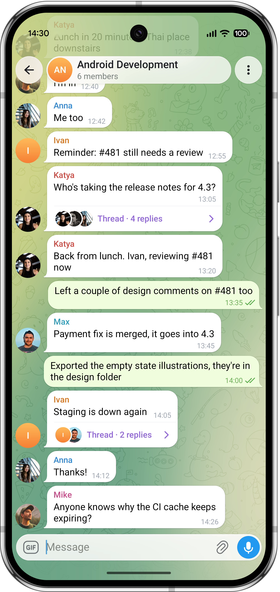
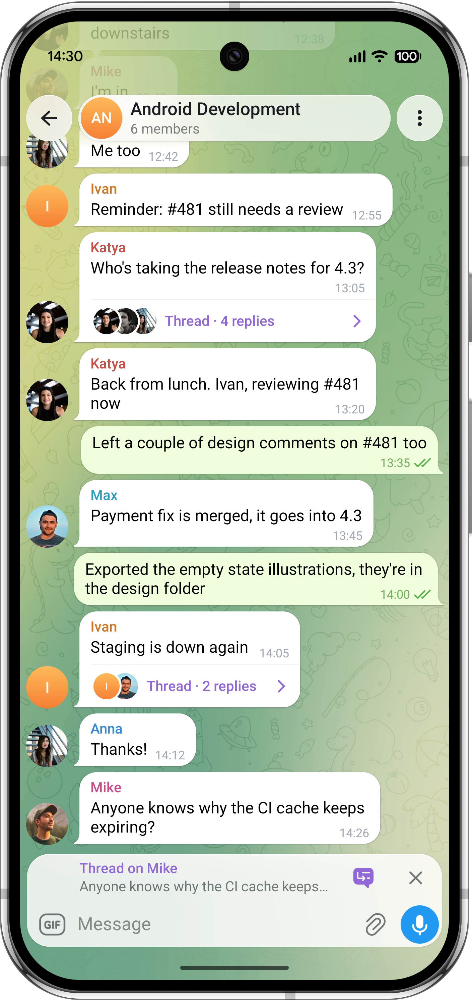
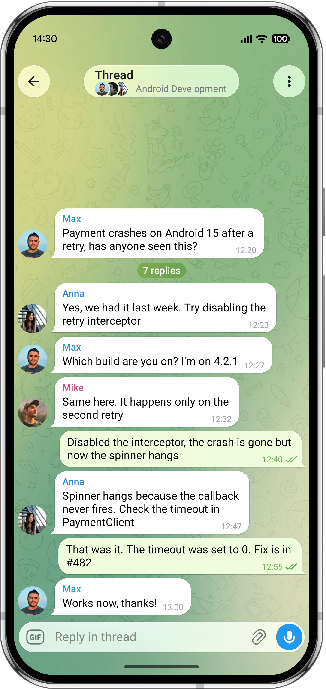
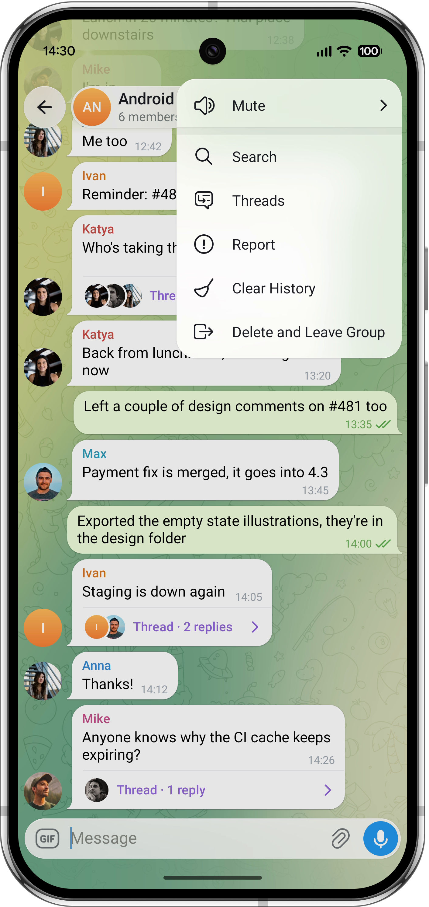
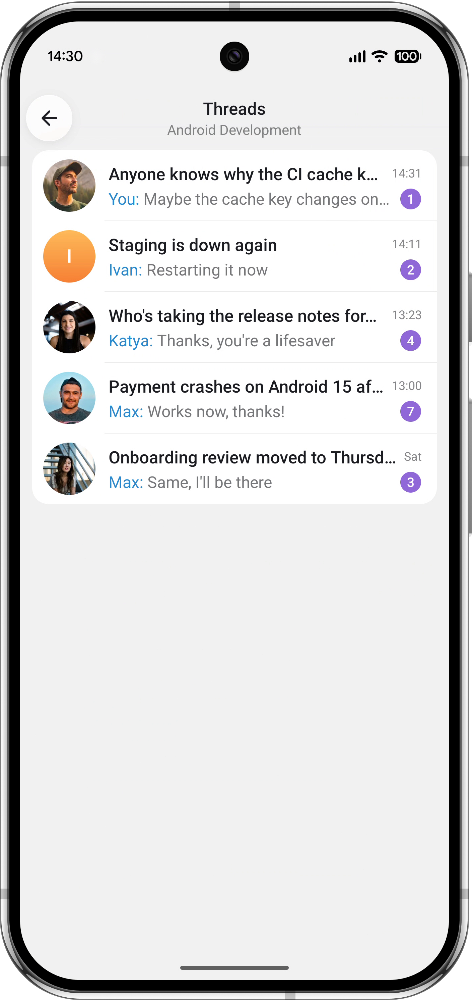
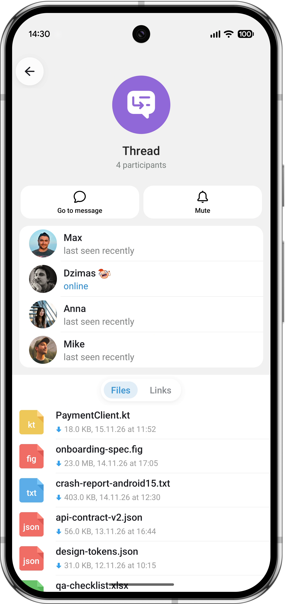

# Telegram Threads

Slack-style threads for the Telegram Android app: reply to any message in a side thread instead of the main chat.

This is a design prototype built on top of the official open-source client
([DrKLO/Telegram](https://github.com/DrKLO/Telegram), version 13.2.2). It is not affiliated with Telegram.

<p>
  
  
  
</p>

## Why

Busy group chats mix several conversations at once. A question about one message gets three answers,
someone posts a link, someone else changes the subject, and the original question scrolls away.
Telegram has comments for channels and topics for forum groups, but nothing for an ordinary group or
private chat where you want to answer *one* message without adding noise for everyone else.

Threads keep a side discussion attached to its message. The main chat stays readable, and the
discussion stays one tap away.

## What it does

- **"Reply in a thread" toggle.** When you reply to a message, the reply panel gets a thread icon next
  to the close button. Tap it and the panel title changes to "Thread on *Name*" in the thread accent color.
  What you send then goes to the message's thread, not to the chat. A one-time tooltip explains the
  toggle the first time the panel opens. You can also select a single message and tap the new
  **Thread** button between Reply and Forward.
- **Thread screen.** The parent message at the top, a "N replies" divider, then the replies, with
  Telegram's own message bubbles, input field, emoji, stickers and GIF panel. The glass header shows
  "Thread · N replies", the chat name and the avatars of the latest participants.
- **Indicator row "Thread · N replies".** Under a message that has a thread, the bubble gets a row with
  up to three participant avatars and the reply count, styled like a channel post's comment bar.
  Tap it to open the thread.
- **Threads list via the ⋮ menu.** The chat's ⋮ menu gets a **Threads** item (right after Search, and
  only while the chat has at least one thread). It lists every thread of the chat with its parent
  message, last reply and count.
- **Thread info screen.** Tap the thread header to open an info screen modeled on Telegram's profile
  screen: a large thread icon, the parent message, Mute, Members (with a full members list), and a
  shared-media block with **Files** and **Links** tabs. Scrolling up shrinks the avatar circle and
  merges it into the front camera cutout, the same effect as Telegram's profile.

<p>
  
  
  
</p>

## Limitations

- **Threads are stored locally only.** Replies live in the app's SharedPreferences on this device.
  There is no server sync: other chat members don't see your threads, and nothing about a thread is
  ever sent to Telegram's servers. Reinstalling the app or clearing its data removes them.
- **Replies are text only.** A thread reply has no photos, files or voice messages. Because of that the
  Files and Links tabs of the thread info screen are hidden in real chats; they only have content in the
  demo chat (see below).
- **Mute is local** and only stored as a setting; there are no thread notifications to mute yet.
- **The demo chat is debug-only.** The "Android Development" chat used in the video comes from
  `demo.patch`, exists only in debug builds and only in memory.
- **Tested on the Day theme** on a Pixel 9 Pro (Android 17). Other themes use the same Telegram theme
  keys but were not checked screen by screen.
- English strings only.
- A message whose channel post already has real comments keeps Telegram's comment bar, not the thread row.

## How it works

All new code is in one package, `org.telegram.ui.threads`. Every change to an existing Telegram file is
marked with a `// THREADS` comment, so `grep -rn "THREADS"` shows the whole feature.

| Component | Source file |
| --- | --- |
| Local storage of replies, counts, participants, mute, list of threads | [`ThreadsStore.java`](Threads/ThreadsStore.java) |
| Thread screen (parent message, replies, input with emoji / stickers / GIF) | [`ThreadActivity.java`](Threads/ThreadActivity.java) |
| Glass header of the thread screen: title, chat name, avatar stack | [`ThreadHeaderView.java`](Threads/ThreadHeaderView.java) |
| Threads list of a chat (from the ⋮ menu) | [`ThreadsListActivity.java`](Threads/ThreadsListActivity.java) |
| Thread info screen: hero block, Mute, Members, Files / Links, avatar-into-camera scroll | [`ThreadInfoActivity.java`](Threads/ThreadInfoActivity.java) |
| Full list of a thread's members | [`ThreadMembersActivity.java`](Threads/ThreadMembersActivity.java) |
| Feature constants: icons, purple accent, tooltip text | [`ThreadsConfig.java`](Threads/ThreadsConfig.java) |
| Thread icon, off (outline) and on (filled) | [`ic_thread_outline.xml`](Threads/ic_thread_outline.xml), [`ic_thread_filled.xml`](Threads/ic_thread_filled.xml) |

The `Threads/` folder holds copies of the new files for reading on GitHub. `changes.patch` contains the
same files plus the edits to existing Telegram files.

## Changes outside the module

| Telegram file | What changes |
| --- | --- |
| `ui/ChatActivity.java` | Reply-panel toggle and "Thread on *Name*" title, sending into a thread, first-time tooltip, ⋮ → Threads item, opening a thread from the indicator row, refreshing the row on return |
| `ui/Cells/ChatMessageCell.java` | The "Thread · N replies" indicator row with the avatar stack, reusing the channel comment bar |
| `ui/Components/ChatActivityEnterView.java` | A small hook (`threadsSendInterceptor`) so the chat can send the text to the thread instead of the chat |
| `ui/Components/EditTextEmoji.java` | A flag to show the Stickers and GIF tabs in the thread screen's emoji panel (off for every other screen) |
| `ui/Components/chat/layouts/ChatActivityActionsButtonsLayout.java` | The **Thread** button between Reply and Forward in the selection panel |
| `res/values/strings.xml` | 13 new `Threads*` strings |
| `res/drawable/ic_thread_*.xml` | The two thread icons (new files) |

### demo.patch (optional, debug builds only)

`demo.patch` adds what was used to record the demo video. None of it runs in release builds.

| File | What it adds |
| --- | --- |
| `ui/threads/ThreadsDemoChat.java` | The in-memory "Android Development" group: members, messages, files and links, its own fixed clock |
| `ui/threads/ThreadsDemo.java` | Scripted thread replies and placeholder people |
| `ui/threads/ThreadsDemoInput.java` | No on-screen keyboard in the demo chat, and an adb broadcast that types text into the focused field |
| `TMessagesProj_App/src/debug/assets/threads_demo/*.jpg` | Avatars of the demo people |
| `ui/DialogsActivity.java` | "Load demo chat" / "Remove demo chat" in the chat list's ⋮ menu |
| `messenger/MessagesController.java`, `MediaDataController.java`, `SendMessagesHelper.java`, `tgnet/ConnectionsManager.java` | Keep the demo chat in memory: its messages and members come from the app, and no request about it reaches the server |
| `messenger/AndroidUtilities.java`, `ui/ChatActivity.java` | Keyboard guard for the demo chat, hiding the "Dump Canvas" debug item, no profile tap on the demo header |
| `ui/threads/Thread*.java`, `ThreadsStore.java` | Debug items in the thread screen's ⋮ menu (load a demo conversation, reset the tooltip), demo threads kept in memory, Files / Links of the demo chat |

## Trying it

1. Get the base source and its submodules:

   ```bash
   git clone --recursive https://github.com/DrKLO/Telegram.git
   cd Telegram
   git checkout 21f7d109da6ab3506c9e9577f98c6a38771ab335   # "update to 13.2.2 (7303)"
   git submodule update --init --recursive
   ```

2. Apply the feature, and optionally the demo:

   ```bash
   git apply /path/to/telegram-threads/changes.patch
   git apply /path/to/telegram-threads/demo.patch    # optional, debug builds only
   ```

3. Put your own `api_id` / `api_hash` into `TMessagesProj/src/main/java/org/telegram/messenger/BuildVars.java`
   (get them at [my.telegram.org](https://my.telegram.org)), then build with the normal Gradle build, for example:

   ```bash
   ./gradlew :TMessagesProj_App:assembleAfatDebug
   ```

4. In the app:
   - Open any group or private chat and swipe a message to reply.
   - In the reply panel, tap the thread icon left of the ✕. The title turns purple: "Thread on *Name*".
   - Type and send. The message now shows **Thread · 1 reply**; tap that row to open the thread.
   - In the thread, tap the header to open the thread info screen, and scroll up to see the avatar merge into the camera.
   - Back in the chat, open ⋮ → **Threads** to see every thread of the chat.
   - With `demo.patch` in a debug build: chat list ⋮ → **Load demo chat** opens a ready-made group with threads,
     files and links. ⋮ → **Remove demo chat** removes it.

## License

Telegram for Android is licensed under GNU GPL v2 (or later). These patches modify it and are
distributed under the same license.
